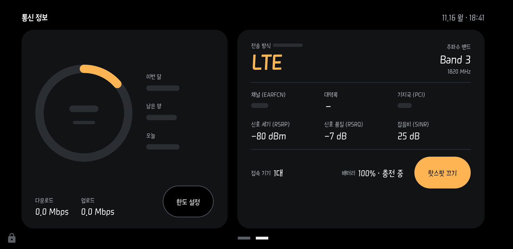

# Router Viewer

갤럭시 노트9를 휴대용 라우터처럼 쓸 때 켜 두는 가로 대기화면 앱입니다.
시계·달력 화면과, 옆으로 넘기면 나오는 통신 정보 화면 두 장으로 구성됩니다.




<sub>스크린샷의 통신사 이름, 채널 번호, 기지국 번호, 데이터 사용량은 가렸습니다.</sub>

## 기능

- **시계·달력 화면**: 날짜, 큰 시계, 이번 달 달력(오늘 강조), 네트워크·오늘 사용량·접속 기기·배터리 요약
- **통신 정보 화면**
  - 이번 달 모바일 데이터 사용량을 월 한도 대비 원형 그래프로 표시 (남은 양, 오늘 사용량 포함)
  - 실시간 다운로드·업로드 속도
  - 전송 방식(LTE 등), 통신사, 주파수 밴드와 하향 주파수, EARFCN, 대역폭, PCI, RSRP, RSRQ, SINR
  - 핫스팟 접속 기기 수, 배터리·충전 상태
  - 핫스팟 켜기·끄기 버튼
- **한도 설정**: 월 데이터 한도, 사용량 기준일(매월 1~31일), 이번 달 사용량 보정(통신사 집계에 맞추기)
- **잠금화면 위 표시**: 폰을 잠근 채로 앱이 보이고, 앱을 나가면 잠금화면으로 돌아갑니다. 왼쪽 아래 자물쇠 아이콘으로 잠금 상태를 표시합니다(회색 닫힘 = 잠김, 주황 열림 = 풀림).
- **자동 실행**: 핫스팟이 켜진 상태에서 충전기를 꽂으면 앱이 자동으로 뜹니다.
- **번인 완화**: 검은 배경, 1분마다 화면 전체를 몇 픽셀씩 이동

## 확인한 환경

- 갤럭시 노트9 (SM-N960N), Android 10, SKT LTE
- 다른 기기에서는 시험하지 않았습니다. 핫스팟 인터페이스 이름(`swlan0`) 등 삼성 기기에 맞춘 부분이 있습니다.

## 빌드

JDK 17 이상과 Android SDK(compileSdk 35)가 필요합니다. Gradle은 실행 스크립트가 자동으로 받습니다.

```sh
./gradlew assembleDebug        # Windows: gradlew.bat assembleDebug
```

결과물: `build/outputs/apk/debug/RouterViewer-debug.apk`

계산 로직(밴드 계산, 사용량 기준일, 접속 기기 집계) 자체 점검:

```sh
java -ea src/main/java/com/routerviewer/Calc.java   # "Calc OK" 출력
```

## 설치와 권한

```sh
adb install -r build/outputs/apk/debug/RouterViewer-debug.apk
```

앱이 처음 실행될 때나 해당 기능을 처음 쓸 때 권한을 요청합니다.

| 권한 | 용도 | 허용 방법 |
|---|---|---|
| 위치, 전화 상태 | 셀 정보(밴드, 신호), 전송 방식 | 첫 실행 시 팝업 |
| 다른 앱 위에 표시 | 충전기 연결 시 자동 실행 | 첫 실행 시 설정 화면 |
| 사용 기록 액세스 | 데이터 사용량 | 원형 그래프를 탭 |
| 시스템 설정 변경 | 핫스팟 켜기·끄기 | 핫스팟 버튼을 처음 누를 때 |

adb로 한 번에 허용할 수도 있습니다.

```sh
adb shell pm grant com.routerviewer android.permission.ACCESS_FINE_LOCATION
adb shell pm grant com.routerviewer android.permission.READ_PHONE_STATE
adb shell appops set com.routerviewer SYSTEM_ALERT_WINDOW allow
adb shell appops set com.routerviewer GET_USAGE_STATS allow
adb shell appops set com.routerviewer WRITE_SETTINGS allow
```

셀 정보가 나오려면 빠른 설정의 위치도 켜져 있어야 합니다.

## 사용 팁

- 앱을 띄운 뒤 전원 버튼으로 한 번 잠그고 다시 켜 두면, 누가 만져도 앱 밖으로 나가는 순간 잠금화면이 나옵니다.
- 노트9가 다른 Wi-Fi에 붙어 있으면 핫스팟 트래픽이 LTE가 아니라 그 Wi-Fi로 나가서 사용량과 속도에 잡히지 않습니다. 라우터로 쓸 때는 Wi-Fi를 꺼 두세요.
- 삼성 배터리 관리가 앱을 절전 상태로 돌리면 자동 실행이 안 될 수 있습니다. 설정 › 배터리 › 백그라운드 사용 제한에서 절전 예외 앱으로 지정하세요.
- 설정에서 앱을 "강제 중지"하면 다시 직접 실행하기 전까지 자동 실행이 동작하지 않습니다.

## 제한 사항

- **targetSdk 25**: 핫스팟 제어에 쓰는 숨김 API(`IConnectivityManager.startTethering`)는 targetSdk 27 이하에서만, 충전기 연결 알림을 앱이 꺼져 있을 때 받는 것은 targetSdk 25 이하에서만 허용됩니다. 그래서 Play 스토어에 올릴 수 없고, 직접 설치(사이드로드) 전용입니다. 숨김 API 호출이 실패하면 삼성 핫스팟 설정 화면을 엽니다.
- 노트9 펌웨어는 셀 대역폭 값을 주지 않아 "—"로 표시됩니다.
- 주파수 묶음(CA)의 보조 밴드는 볼 수 없고 주 셀만 표시합니다.
- 사용량은 안드로이드 통계를 읽기 때문에 트래픽이 적을 때는 수십 분 늦게 반영될 수 있습니다. 속도는 실시간입니다.
- 1 GB = 1024³ 바이트로 계산합니다. 통신사 집계와 다르면 한도 설정의 사용량 보정으로 맞추세요.
- 접속 기기 수는 `ip neigh` 결과에서 핫스팟 쪽 기기를 세므로, 기기가 끊긴 뒤 몇 분간 남아 있을 수 있습니다.

## 구조

```
src/main/java/com/routerviewer/
  MainActivity.java      두 화면, 데이터 수집, 핫스팟 버튼, 잠금 아이콘
  SettingsActivity.java  한도 설정 화면
  AutoStartReceiver.java 충전기 연결 시 자동 실행
  RingView.java          사용량 원형 그래프
  Calc.java              밴드·기준일·접속 기기 계산 (안드로이드 비의존, 자체 점검 포함)
src/main/res/            레이아웃, 아이콘, 색상
```

추가 라이브러리 없이 Android 기본 API만 사용합니다.
