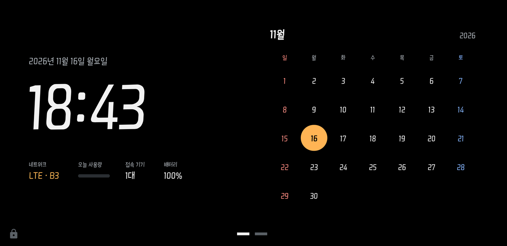

# Router Viewer

갤럭시 노트9를 휴대용 라우터처럼 쓸 때 켜 두는 가로 대기화면 앱입니다.
시계·달력 화면과, 옆으로 넘기면 나오는 통신 정보 화면 두 장으로 구성됩니다.




<sub>스크린샷의 통신사 이름, 채널 번호, 기지국 번호, 데이터 사용량은 가렸습니다.</sub>

## 기능

- **시계·달력 화면**: 날짜, 큰 시계, 이번 달 달력(오늘 강조), 네트워크·오늘 사용량·접속 기기·배터리 요약
- **통신 정보 화면**
  - 이번 달 모바일 데이터 사용량을 월 한도 대비 원형 그래프로 표시 (남은 양, 오늘 사용량 포함)
  - 실시간 다운로드·업로드 속도
  - 전송 방식(LTE 등), 통신사, 주파수 밴드와 하향 주파수, EARFCN, 대역폭, PCI, RSRP, RSRQ, SINR
  - 핫스팟 접속 기기 수, 배터리·충전 상태
  - 핫스팟 켜기·끄기 버튼
- **한도 설정**: 월 데이터 한도, 사용량 기준일(매월 1~31일), 이번 달 사용량 보정(통신사 집계에 맞추기)
- **잠금화면 위 표시**: 폰을 잠근 채로 앱이 보이고, 앱을 나가면 잠금화면으로 돌아갑니다. 왼쪽 아래 자물쇠 아이콘으로 잠금 상태를 표시합니다(회색 닫힘 = 잠김, 주황 열림 = 풀림).
- **자동 실행**: 핫스팟이 켜진 상태에서 충전기를 꽂으면 앱이 자동으로 뜹니다.
- **SOCKS5 프록시**: 핫스팟이 켜져 있으면 `192.168.43.1:1080`에 프록시가 열립니다. 이 프록시를 거친 트래픽은 안드로이드에서 테더링이 아니라 앱 자신의 데이터로 집계됩니다. 아래 [SOCKS5 프록시](#socks5-프록시) 참고.
- **번인 완화**: 검은 배경, 1분마다 화면 전체를 몇 픽셀씩 이동

## 확인한 환경

- 갤럭시 노트9 (SM-N960N), Android 10, SKT LTE
- 다른 기기에서는 시험하지 않았습니다. 핫스팟 인터페이스 이름(`swlan0`) 등 삼성 기기에 맞춘 부분이 있습니다.

## 빌드

JDK 17 이상과 Android SDK(compileSdk 35)가 필요합니다. Gradle은 실행 스크립트가 자동으로 받습니다.

```sh
./gradlew assembleDebug        # Windows: gradlew.bat assembleDebug
```

결과물: `build/outputs/apk/debug/RouterViewer-debug.apk`

자체 점검 (PC에서 바로 실행, 안드로이드 불필요):

```sh
java -ea src/main/java/com/routerviewer/Calc.java     # 밴드 계산, 사용량 기준일, 접속 기기 집계 → "Calc OK"
java -ea src/main/java/com/routerviewer/Socks5.java   # SOCKS5 연결·중계·UDP 중계·오류 응답 → "Socks5 OK"
```

## 설치와 권한

```sh
adb install -r build/outputs/apk/debug/RouterViewer-debug.apk
```

앱이 처음 실행될 때나 해당 기능을 처음 쓸 때 권한을 요청합니다.

| 권한 | 용도 | 허용 방법 |
|---|---|---|
| 위치, 전화 상태 | 셀 정보(밴드, 신호), 전송 방식 | 첫 실행 시 팝업 |
| 다른 앱 위에 표시 | 충전기 연결 시 자동 실행 | 첫 실행 시 설정 화면 |
| 사용 기록 액세스 | 데이터 사용량 | 원형 그래프를 탭 |
| 시스템 설정 변경 | 핫스팟 켜기·끄기 | 핫스팟 버튼을 처음 누를 때 |

adb로 한 번에 허용할 수도 있습니다.

```sh
adb shell pm grant com.routerviewer android.permission.ACCESS_FINE_LOCATION
adb shell pm grant com.routerviewer android.permission.READ_PHONE_STATE
adb shell appops set com.routerviewer SYSTEM_ALERT_WINDOW allow
adb shell appops set com.routerviewer GET_USAGE_STATS allow
adb shell appops set com.routerviewer WRITE_SETTINGS allow
```

셀 정보가 나오려면 빠른 설정의 위치도 켜져 있어야 합니다.

## 사용 팁

- 앱을 띄운 뒤 전원 버튼으로 한 번 잠그고 다시 켜 두면, 누가 만져도 앱 밖으로 나가는 순간 잠금화면이 나옵니다.
- 노트9가 다른 Wi-Fi에 붙어 있으면 핫스팟 트래픽이 LTE가 아니라 그 Wi-Fi로 나가서 사용량과 속도에 잡히지 않습니다. 라우터로 쓸 때는 Wi-Fi를 꺼 두세요.
- 삼성 배터리 관리가 앱을 절전 상태로 돌리면 자동 실행이 안 될 수 있습니다. 설정 › 배터리 › 백그라운드 사용 제한에서 절전 예외 앱으로 지정하세요.
- 설정에서 앱을 "강제 중지"하면 다시 직접 실행하기 전까지 자동 실행이 동작하지 않습니다.

## SOCKS5 프록시

일반 핫스팟은 노트북이 만든 패킷을 폰이 그대로 중계하므로 안드로이드에서 테더링 트래픽으로 집계됩니다.
프록시를 쓰면 노트북은 폰 앱에 요청만 보내고, 폰 앱이 직접 인터넷에 연결합니다. 그래서 폰의 한 앱이 쓴 데이터로 집계됩니다.

노트9에서 같은 10 MB를 받아 안드로이드 사용량 통계를 비교한 결과:

| 경로 | 앱 몫 | 테더링 몫 |
|---|---|---|
| 핫스팟으로 직접 | 변화 없음 | +10.46 MB |
| 프록시 경유 | +10.55 MB | +약 10 KB |

통신사가 이 트래픽을 어떻게 분류하는지는 확인하지 않았습니다. 통신사 요금제 약관이 테더링 우회 사용을 금지할 수 있으니 확인하고 쓰세요.

**동작**

- 핫스팟이 켜져 있으면 자동으로 켜지고, 꺼지면 함께 꺼집니다(앱 화면이 떠 있을 때 5초마다 확인). 실행 중에는 상시 알림이 표시되고, 통신 정보 화면 상단에 주소와 연결 수가 나옵니다.
- 핫스팟 주소에서만 열리므로 핫스팟에 붙은 기기만 쓸 수 있습니다. 인증은 없습니다.
- 도메인 이름 조회(DNS)도 폰이 합니다.

**노트북 전체를 프록시로 보내기 (권장)**

[sing-box](https://github.com/SagerNet/sing-box)가 노트북에 가상 네트워크 카드를 만들어, 모든 프로그램의 TCP·UDP·DNS를 폰 프록시로 보냅니다. 프로그램마다 설정할 필요가 없습니다.

1. [sing-box 릴리스](https://github.com/SagerNet/sing-box/releases)에서 `sing-box-<버전>-windows-amd64.zip`을 받아 `sing-box.exe`를 `pc/` 폴더에 넣습니다 (1.14.4에서 확인).
2. `pc/build.bat`을 실행하면 `pc/RouterViewerPC.exe`가 만들어집니다. Windows에 기본으로 들어 있는 .NET Framework 컴파일러를 쓰므로 따로 설치할 것은 없습니다.
3. 노트북을 핫스팟에 연결하고 폰에서 앱을 띄워 프록시가 켜진 것을 확인합니다.
4. `RouterViewerPC.exe`를 실행합니다. 관리자 권한을 요청하고, 폰 프록시가 응답하면 바로 연결합니다. 창의 버튼으로 끊거나 다시 연결할 수 있고, 아래쪽에 sing-box 기록이 나옵니다.
5. 창을 닫으면 연결을 끊고 원래 핫스팟 연결로 돌아옵니다.

`RouterViewerPC.exe`, `sing-box.exe`, `config.json`은 같은 폴더에 있어야 합니다.

켜져 있는 동안 폰 프록시가 꺼지면 노트북 인터넷이 끊깁니다(핫스팟으로 몰래 새지 않음). `ping`은 TCP·UDP가 아니라서 프록시를 지나지 못해 실패하지만, 인터넷 사용에는 지장이 없습니다. 설정은 `pc/config.json`에 있습니다.

**프로그램별로 지정하기**

- Firefox: 설정 › 네트워크 설정 › 수동 프록시 설정에서 SOCKS 호스트 `192.168.43.1`, 포트 `1080`, SOCKS v5를 고르고 "SOCKS v5 사용 시 DNS 프록시"를 체크
- Chrome / Edge: 실행 옵션으로 지정
  ```bat
  msedge.exe --proxy-server="socks5://192.168.43.1:1080"
  ```
- curl
  ```sh
  curl --socks5-hostname 192.168.43.1:1080 https://example.com
  ```

Windows 기본 프록시 설정은 SOCKS5를 제대로 지원하지 않으므로 프로그램별로 지정해야 합니다.

**한계**

- TCP 연결(CONNECT)과 UDP 중계(UDP ASSOCIATE)를 처리합니다. 프로그램별로 지정하는 방식에서는 프록시 설정을 따르지 않는 프로그램과 UDP가 핫스팟으로 직접 나갑니다. 노트북 전체를 보내는 방식에서는 ping(ICMP)만 빠집니다.
- UDP가 앱 데이터로 집계되는지는 TCP처럼 사용량을 비교해 측정하지는 않았습니다. 같은 앱 소켓으로 내보내므로 같게 집계될 것으로 봅니다.
- 연결마다 스레드 두 개를 쓰는 단순한 구조라, 브라우저 몇 개 수준을 넘는 대량 연결에는 맞지 않습니다.

## 제한 사항

- **targetSdk 25**: 핫스팟 제어에 쓰는 숨김 API(`IConnectivityManager.startTethering`)는 targetSdk 27 이하에서만, 충전기 연결 알림을 앱이 꺼져 있을 때 받는 것은 targetSdk 25 이하에서만 허용됩니다. 그래서 Play 스토어에 올릴 수 없고, 직접 설치(사이드로드) 전용입니다. 숨김 API 호출이 실패하면 삼성 핫스팟 설정 화면을 엽니다.
- 노트9 펌웨어는 셀 대역폭 값을 주지 않아 "—"로 표시됩니다.
- 주파수 묶음(CA)의 보조 밴드는 볼 수 없고 주 셀만 표시합니다.
- 사용량은 안드로이드 통계를 읽기 때문에 트래픽이 적을 때는 수십 분 늦게 반영될 수 있습니다. 속도는 실시간입니다.
- 1 GB = 1024³ 바이트로 계산합니다. 통신사 집계와 다르면 한도 설정의 사용량 보정으로 맞추세요.
- 접속 기기 수는 `ip neigh` 결과에서 핫스팟 쪽 기기를 세므로, 기기가 끊긴 뒤 몇 분간 남아 있을 수 있습니다.

## 구조

```
src/main/java/com/routerviewer/
  MainActivity.java      두 화면, 데이터 수집, 핫스팟 버튼, 잠금 아이콘
  SettingsActivity.java  한도 설정 화면
  AutoStartReceiver.java 충전기 연결 시 자동 실행
  ProxyService.java      핫스팟 주소에서 SOCKS5 프록시 실행 (포그라운드 서비스)
  Socks5.java            SOCKS5 서버 (안드로이드 비의존, 자체 점검 포함)
  RingView.java          사용량 원형 그래프
  Calc.java              밴드·기준일·접속 기기 계산 (안드로이드 비의존, 자체 점검 포함)
src/main/res/            레이아웃, 아이콘, 색상
pc/
  config.json            노트북 전체를 폰 프록시로 보내는 sing-box 설정
  RouterViewerPC.cs      연결·끊기 창 프로그램 (sing-box 실행·종료, 폰 프록시 확인)
  app.manifest           관리자 권한 요청
  build.bat              RouterViewerPC.exe 빌드
```

추가 라이브러리 없이 Android 기본 API만 사용합니다.
